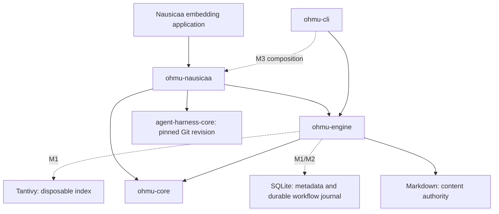

# Architecture

Status: S0 plus M1 local Markdown/HTML/PDF source storage/catalog are implemented.
[SOURCES](SOURCES.md) describes the implemented addition. Other M1–M4 behaviors
remain planned unless explicitly marked complete in PLAN. [PLAN](PLAN.md) defines stage exits; [ADR](ADR.md) records decisions.

## Ownership and dependency direction



The engine never depends on the harness. The adapter does not own a model or an
agent loop. A trusted composition host registers tools, grants capabilities,
installs an executor and selects an event store. The CLI currently uses only the
engine; the example demonstrates harness composition separately.

The domain crate currently exports validated PageId, PageSnapshot, WikiConfig and
version/read-limit constants. Source IDs, content hashes, source records, document nodes, parsed documents and
source locators/passages are also implemented. Changeset types remain planned.

## Implemented storage and read semantics

```text
<wiki>/
  ohmu.toml             # schema_version = 1; name; no model credentials
  pages/welcome.md      # user-editable content
  raw/                  # immutable blobs, parser artifacts, caches and provenance records
  .ohmu/                # derived source catalog and source writer lock
```

`Wiki::init` creates only a previously nonexistent directory. The parent must
exist. Failure leaves partial state for inspection rather than deleting files.
An invalid or oversized initial configuration fails before directory creation.
Files and created directory entries are synced; initialization is not a
recoverable transaction, and its parent directory is not fsynced for a power-loss
guarantee. A repeat initialization refuses to overwrite anything.

Configuration is capped at 16 KiB, rejects unknown fields/versions and requires a
nonempty name. Page IDs are 1–96 lowercase ASCII letters, digits, hyphens or
underscores, starting with a letter or digit. They map to flat `pages/<id>.md`
paths. Titles and human-readable content can use any UTF-8 text.

The engine holds root and pages directory descriptors. Descriptor-relative opens
refuse symlinks in layout/file components. Content must be a regular UTF-8 file,
bounded to 256 KiB, opened nonblocking to avoid a substituted FIFO blocking the
reader. Size and modification metadata are checked around the read. The revision
is SHA-256 over the exact returned bytes, including frontmatter.

These are filesystem checks, not an OS sandbox. Ancestor directories are trusted;
the final root component is opened without following a link, subject to OS path
resolution behavior. An already-open reader stays attached to its original pages
directory after a rename. Reopen the engine when deliberately replacing that
directory. The metadata check detects ordinary concurrent changes, not every
possible same-size in-place race. S0 provides neither external editor locking nor
a multi-page snapshot. A prepared tool rechecks its page hash before returning.

`doctor` revalidates config and required directory layout without model access or
writes. It is not a content validator, writability test, or permission audit.

## Planned content model (M1–M2)

- Source identity separates a logical source from immutable SHA-256 revisions.
  Each revision records raw bytes, retrieval URL/path, retrieval time, media type,
  parser/version and normalized text artifacts. A changed URL body is a new
  revision; the previous snapshot remains addressable.
- Document nodes contain a revision, parent/order, heading, text span and optional
  physical page range. Prefer actual headings/bookmarks; a PDF without reliable
  structure remains a page tree rather than an invented table of contents.
- Evidence locators identify source revision plus a 1-based PDF physical page or
  a half-open UTF-8 byte range in a versioned normalized-text artifact. Quotes are
  checked against those bytes. Original PDF bytes remain available for inspection.
- Wiki pages keep a stable ID in frontmatter, a human title, explicit aliases,
  source references and Markdown links. Page ingestion does not yet validate frontmatter;
  M1 must reject ID/path disagreement and duplicate IDs during reconciliation.
- Links and entity relationships use SQLite adjacency tables with incoming and
  outgoing lookup; no graph database. An alias never silently merges entities.
- Changesets contain full replacement page bytes, expected prior hashes (or
  explicit create intent), citations, proposed links and a summary. M2 supports
  page creation/update; deletion and rename are deferred to avoid dangling data.

SQLite will contain rebuildable catalogs (sources, nodes, pages, links, aliases,
citations, index generations) and non-disposable workflow data (drafts, apply
operations and checkpoints). Backups must preserve the latter; rebuilding an
index is not a substitute for backing up draft/recovery state.

## Planned ingestion, retrieval and generation (M1–M3)

Ingestion copies source bytes into content-addressed storage, records provenance,
parses normalized content with locators, builds deterministic nodes, then indexes
those nodes. Original sources are read-only to the model. Source ingestion and
indexing do not publish Wiki content. LLM summaries supplement rather than replace
the normalized text. Processing is revision-aware and resumable at completed
checkpoints; in-flight model calls are not represented as completed work.

Markdown uses source offsets and heading levels. Static HTML uses readability
extraction, retaining both fetched bytes and normalized output. JavaScript pages
return an unsupported/empty-extraction result. PDF extraction preserves physical
pages, flags image-only documents for OCR and makes no table/layout fidelity
claim. Initial limits: 50 MiB per source, 2,000 PDF pages, 30-second HTTP timeout,
at most five validated redirects, bounded extraction output of 16 MiB. HTTP
imports are explicit operations; private/local destinations are refused by
default, including redirect targets. There is no crawler in v1.

Index Wiki sections and normalized source nodes as separate collections. Use
title/alias/heading/body field weights of 4/3/2/1; BM25 candidates carry content
revisions. Use the same Chinese Jieba/Latin lowercase tokenizer in indexing and
querying, preserving exact ID fields. Maintain a versioned tokenizer configuration;
a change requires rebuilding the index. v1 does not promise transliteration or
automatic simplified/traditional Chinese equivalence.

Start with 20 candidates, inspect at most three navigation hops and permit at
most two query rewrites. Read bounded passages; never send the entire index or
corpus as a prompt. Exact IDs and aliases provide deterministic entry points.
LLM navigation operates on candidate node IDs, not arbitrary paths. Invalid node
IDs are rejected. Explicit source searches can fall back to a bounded live scan
when the index is unavailable; normal search reports a stale/unavailable index
rather than inventing a result. Drafts are excluded from published search.

Queries freeze a reconciled content manifest. Retrieval verifies returned
revisions and serves retained immutable page snapshots for that query. Reconcile
ordinary external edits before freezing a new manifest. If a stable snapshot
cannot be obtained, report a conflict. This is an M2 requirement, not an S0 claim.

The host uses Nausicaa for model/tool iterations. It assembles supported claims
and source citations, flags contradictions and distinguishes source evidence
from synthesis. Validate IDs, ranges and quote matching deterministically; a
passing validator does not prove that an inference is correct. Insufficient
evidence produces an incomplete answer. Filing an answer creates a draft only.

## Planned publication and recovery (M2)

One cross-process writer lock covers reconciliation and publication in a wiki.
Prepare an immutable changeset digest and expected base manifest; validate
citations, links and all target versions before publication. Persist backups,
staged files and an apply-operation journal before crossing the first file-write
boundary. Each phase has a durable operation ID.

Publication states are `prepared → applying → committed`, with `conflict` and
`recovery_required` outcomes. Update files using same-filesystem temporary files,
fsync and rename; fsync affected directories. Only after all content writes and
the committed marker are durable may the active engine manifest advance. An
index update can lag; its generation/revision checks must prevent stale content
from appearing current. Ordinary Git commits are optional user history, not the
transaction mechanism.

A filesystem cannot atomically replace multiple ordinary Markdown files. Engine
queries use a completed snapshot; external editors may observe intermediate
files. Recovery inspects the persisted operation manifest and actual hashes:
complete known staged writes or restore known backups only when all target
hashes match a recorded state. Any unrecognized edit becomes a conflict and is
never overwritten automatically. Explicit host recovery must finish before a
new write is permitted. Reapplying a committed operation ID returns its recorded
result. Unknown harness receipts are reconciled against this operation record,
not blindly retried.

Editor writes do not obey engine locks. Hash checks protect ordinary stale-base
updates, but publication cannot guarantee exclusion against an uncooperative
editor racing between check and rename. Document this limitation and recommend
pausing external edits during apply. Preserve backups and detected divergent
bytes; do not describe optimistic checks as an OS-level compare-and-swap.

## Format evolution and failure ownership

S0 config and JSON envelopes use version 1. Unknown config versions fail without
rewriting files. Future durable schemas require versioned migrations, backup and
explicit execution; never silently reinterpret drafts or operation logs.

The harness owns model transcripts and tool receipts. Ohmu owns source revisions,
content versions, drafts and publication reconciliation. Normal `TurnCompleted`
is not independent Wiki acceptance. A shared JSONL event journal has one trusted
host owner; Nausicaa does not provide distributed journal locking.
